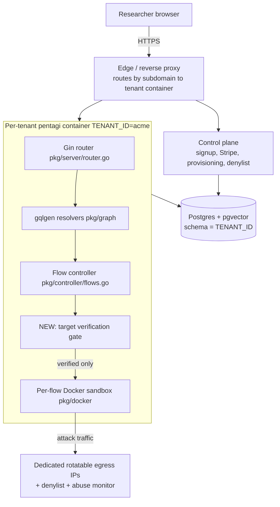

# NullHawk SaaS — Target Architecture

NullHawk is a hosted, vendor-operated fork of PentAGI (MIT). It sells autonomous AI pentesting to individual security researchers. This document describes the target architecture grounded in the current codebase, what we reuse unchanged, and what we build.

All file paths below were verified against the repo on branch `nullhawk-rebrand`.

## What the codebase already gives us

PentAGI is a Go monorepo. The pieces a SaaS needs mostly already exist:

- **Multi-tenancy by `TENANT_ID`.** `backend/pkg/config/tenant.go` derives a PostgreSQL schema (`Config.SchemaName()` returns the tenant id, or `public` when unset), docker object prefixes (`ScopedName`), Graphiti group ids (`GroupID`/`ParseGroupID`), telemetry identity (`TenantUserID`, `TenantTags`), and — critically — a tenant-mixed auth salt (`AuthSalt()` appends `|tenant|<id>`), so a session cookie or API token minted under one tenant is cryptographically invalid under another. `TENANT_ID` is validated by `ValidateTenantID()` against `^[a-z][a-z0-9_]{0,31}$` and is fatal if malformed.
- **Auth.** `backend/pkg/server/auth/auth_middleware.go` already offers session cookies, OAuth2 (Google/GitHub), and bearer API tokens (`AuthUserRequired`, `AuthTokenRequired`, `TryAuth`), with per-route authorization via `auth.PrivilegesRequired("<area>.<action>")` wired in `backend/pkg/server/router.go`. Reuse as-is.
- **Sandboxing.** Per-flow Docker containers via `backend/pkg/docker/` and `backend/pkg/controller/`. This is where attack traffic actually originates.
- **Provider abstraction.** `backend/pkg/providers/` with `providerRegistry` in `registry.go`. Keys are read from config env vars today (see the tenancy decision below).
- **GraphQL + REST + subscriptions.** `backend/pkg/graph/` (gqlgen), `backend/pkg/server/services/` (REST), `backend/pkg/graph/subscriptions/` (pub/sub hub).

## The one tenancy decision that drives everything

The upstream multi-tenancy (`TENANT_ID`) is **schema-per-tenant inside one process**: one running `pentagi` binary serves one `TENANT_ID`, isolating its *data* in a Postgres schema. It is **not** a request-routed, many-tenants-per-process model — there is no per-request tenant switch; `TENANT_ID` is read once from env at boot (`config.go`).

This matters because **LLM API keys are instance-global env vars**, not per-user data. `backend/pkg/config/config.go` holds `OpenAIKey`, `AnthropicAPIKey`, `GeminiAPIKey`, etc., and `providerRegistry` (`backend/pkg/providers/registry.go`) gates each provider with `Enabled: func(c *config.Config) bool { return c.OpenAIKey != "" }` and similar. The per-user `providers` table and the `createProvider` GraphQL mutation (`schema.graphqls:1093`) store only per-agent **model** config (model name, temperature, `extraBody` — see `AgentConfigInput` at `schema.graphqls:884`), **not** credentials. So a provider *type* is only offered in the UI when its key exists at the instance level (`frontend/src/pages/settings/settings-providers.tsx:63-66`, `enabled?.[type]`).

Consequence: **BYO-LLM-key and per-tenant isolation both point to tenant-per-instance.** Give each paying customer their own `pentagi` container (its own `TENANT_ID`, its own env, its own LLM keys, its own egress identity), backed by either a shared Postgres (distinct schemas) or a dedicated DB. This reuses `TENANT_ID` exactly as designed and solves BYO-key for free, at the cost of per-tenant container orchestration. (See `03-billing-and-onboarding.md` for the alternative — a shared pool with keys injected per flow — and why it is more work.)

## Request flow (tenant-per-instance)

## Reuse vs build

| Concern | Decision | Where |
|---|---|---|
| Multi-tenant data isolation | **Reuse** `TENANT_ID` schema-per-tenant | `backend/pkg/config/tenant.go` |
| Auth (sessions, OAuth, tokens) | **Reuse** | `backend/pkg/server/auth/` |
| Per-flow sandbox | **Reuse** | `backend/pkg/docker/`, `backend/pkg/controller/` |
| LLM provider adapters | **Reuse**; keys injected per tenant container | `backend/pkg/providers/` |
| Phone-home to VXControl cloud | **Remove** | `01-remove-phone-home.md` |
| Target-ownership verification | **Build** (new table, schema, resolver, gate) | `02-target-verification.md` |
| Billing + tenant provisioning | **Build** (Stripe + control plane) | `03-billing-and-onboarding.md` |
| Egress / abuse controls | **Build** (hosting + denylist + kill switch) | `04-hosting-egress-abuse.md` |

## Component responsibilities

- **Control plane (new, small service or extension of the installer tooling):** owns signup, Stripe Checkout + webhook, tenant provisioning (creates the schema / spins the container, writes `TENANT_ID` and the customer's LLM keys into that tenant's env), plan/concurrency caps, and the global target denylist distributed to every tenant.
- **Per-tenant `pentagi` container:** the unchanged product plus the new verification gate. One `TENANT_ID`, one set of LLM keys, one egress identity.
- **Egress layer:** dedicated rotatable IPs with published abuse contacts; every flow's sandbox traffic leaves through it. Hooks described in `04-hosting-egress-abuse.md`.
