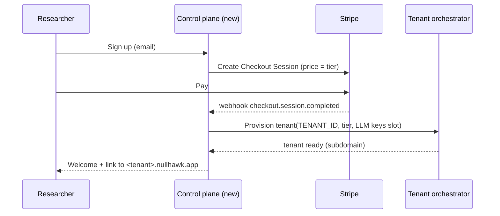

# Billing and Onboarding (Stripe self-serve)

NullHawk sells to individual researchers with self-serve signup. The flow is: signup → Stripe Checkout → webhook → provision a tenant → BYO-LLM-key onboarding → first verified target → first flow. This document grounds the provisioning mechanics in the actual `TENANT_ID` machinery and the existing provider/settings code.

## Plan tiers

| Tier | Price | Concurrency cap (parallel flows) | Notes |
|---|---|---|---|
| Trial | €0, time-boxed | 1 | Verified targets required same as paid; hard monthly flow cap |
| Solo | €39/mo | 1-2 | Single researcher |
| Pro | €99/mo | 4-5 | Power user |

Concurrency is the natural cap because a "flow" is the unit of work and each one spins its own Docker sandbox (`backend/pkg/controller/`, `backend/pkg/docker/`), which is the expensive, abuse-relevant resource.

## Signup → Checkout → webhook → provision

The control plane is a **new, small service** (not in the repo today). It owns Stripe and provisioning; the `pentagi` product stays unaware of billing.

### How "provision a tenant" works given `TENANT_ID`

`TENANT_ID` is validated by `Config.ValidateTenantID()` against `^[a-z][a-z0-9_]{0,31}$` (`backend/pkg/config/tenant.go:21-42`) and read once at boot from env (`backend/pkg/config/config.go:29`). It is **not** a per-request value — one process serves one tenant. So provisioning means standing up the tenant's runtime, not flipping a row.

Given the global-env-key reality (see `00-overview.md`), the recommended model is **tenant-per-container**:

1. Control plane allocates a `TENANT_ID` (derive from a counter or a slug of the account; must match the regex — no hyphens, lowercase, ≤32 chars).
2. Launch a `pentagi` container with that `TENANT_ID`, pointed at the shared Postgres. On boot, goose runs the embedded migrations into the schema named by `Config.SchemaName()` (which returns `TENANT_ID`; `tenant.go:145-150`), so the tenant's schema is created and migrated automatically — **no manual schema SQL needed**. Set a distinct `DATA_DIR`, `DOCKER_PORTS_BASE` (each instance owns `[base, base+2000)` per `.env.example:17-19`), and listen ports, exactly as `.env.example` warns these are not derived from `TENANT_ID`.
3. The edge proxy maps `<tenant>.nullhawk.app` → that container.
4. Seed the admin user / send an invite. (The stack seeds `admin@pentagi.com`; rebrand and set a per-tenant password via the existing account flow.)

Shared Postgres with distinct schemas keeps data isolated through the salt-mixing already in `AuthSalt()` (`tenant.go:167-175`) and `search_path` scoping (`DATABASE_EXTENSIONS_SCHEMA`, `DATABASE_SEARCH_PATH_VIA_OPTIONS` in `.env.example:397-398`).

**Alternative (shared pool, not recommended for v1):** one process serving many tenants would require threading tenant through every request and injecting per-tenant LLM keys per flow — a large change to `config.go` (keys are struct fields, not per-user) and `providerRegistry` (`backend/pkg/providers/registry.go`, `Enabled` reads `*config.Config`). Higher density, much higher engineering and blast-radius risk. Start with tenant-per-container.

## BYO-LLM-key onboarding

**Verified claim, with a caveat.** PentAGI exposes a per-user Providers UI — `frontend/src/pages/settings/settings-providers.tsx` and `settings-provider.tsx` — backed by the GraphQL `createProvider`/`updateProvider`/`deleteProvider` mutations (`backend/pkg/graph/schema.graphqls:1093-1095`) and the per-user `providers` table (`backend/sqlc/models/providers.sql`: `CreateProvider` inserts `user_id, type, name, config`). **But** that `config` JSON stores per-agent *model* settings (`AgentConfigInput` at `schema.graphqls:884`: model, maxTokens, temperature, reasoning, `extraBody` — no key field), **not** the API credential. The actual keys are instance-global env vars in `config.go` (`OpenAIKey`, `AnthropicAPIKey`, `GeminiAPIKey`, …), and a provider *type* is only offered in the UI when its key is set at the instance level: `settings-providers.tsx:63-66` filters `providerTypes` by `enabled?.[type]`, commented "Only offer types whose API key is configured".

So "BYO-LLM-key" works per **tenant**, not per in-process user: because each tenant is its own container (above), the customer's keys go into **that container's env** (`OPEN_AI_KEY`, `ANTHROPIC_API_KEY`, etc. from `.env.example:76-147`), and then the researcher uses Settings→Providers to choose models/agents. The control plane should collect keys at onboarding (or let the user paste them into a first-run settings screen that writes the tenant env and restarts the container) and never store them centrally in plaintext.

If true in-app per-user key entry is wanted later, it is a real feature: add key/baseURL fields to the provider `config` and have `providerRegistry`/the provider controller read the per-user provider's stored credential instead of `*config.Config`. Flag this as out-of-scope for v1.

## Metering and caps — enforcement points

- **Concurrency cap (flows in flight):** enforce in `flowController.CreateFlow` (`backend/pkg/controller/flows.go:276`) — the single choke point, same place as the verification guard (`02-target-verification.md`). The controller already tracks live flows in its `fc.flows` map (seen in `prepareFlow`, `flows.go:329-338`); count the user's active flows and reject when at the tier cap. Tier value comes from the tenant's env/config (add a `PLAN_MAX_CONCURRENT_FLOWS` config field).
- **Monthly flow quota / trial limit:** count rows in the `flows` table for the billing window (`backend/sqlc/models/flows.sql`), checked in the same guard.
- **Both front doors already converge** on `flowController.CreateFlow` (GraphQL `schema.resolvers.go:70`, REST `services/flows.go:373`), so one guard covers API and UI.
- **Billing state → caps:** the control plane updates the tenant's plan (env/config) on Stripe `customer.subscription.updated`/`deleted` webhooks; a cancelled sub drops the tenant to a read-only/paused tier (reject new `CreateFlow`).
- **Usage signal for invoicing/limits:** reuse the existing analytics queries (`backend/sqlc/models/analytics.sql`) rather than building new metering, if per-flow/per-token counts are already recorded there (verify before relying on it).

## Effort / risk

Stripe + control plane is standard SaaS plumbing (~1 week). The real risk is the **tenant orchestration** (launching/retiring per-tenant containers, port/`DATA_DIR` allocation, edge routing, key handling) and the **honest BYO-key limitation** — the product does not store LLM keys per-user, so the whole BYO story rests on tenant-per-container being built correctly.
